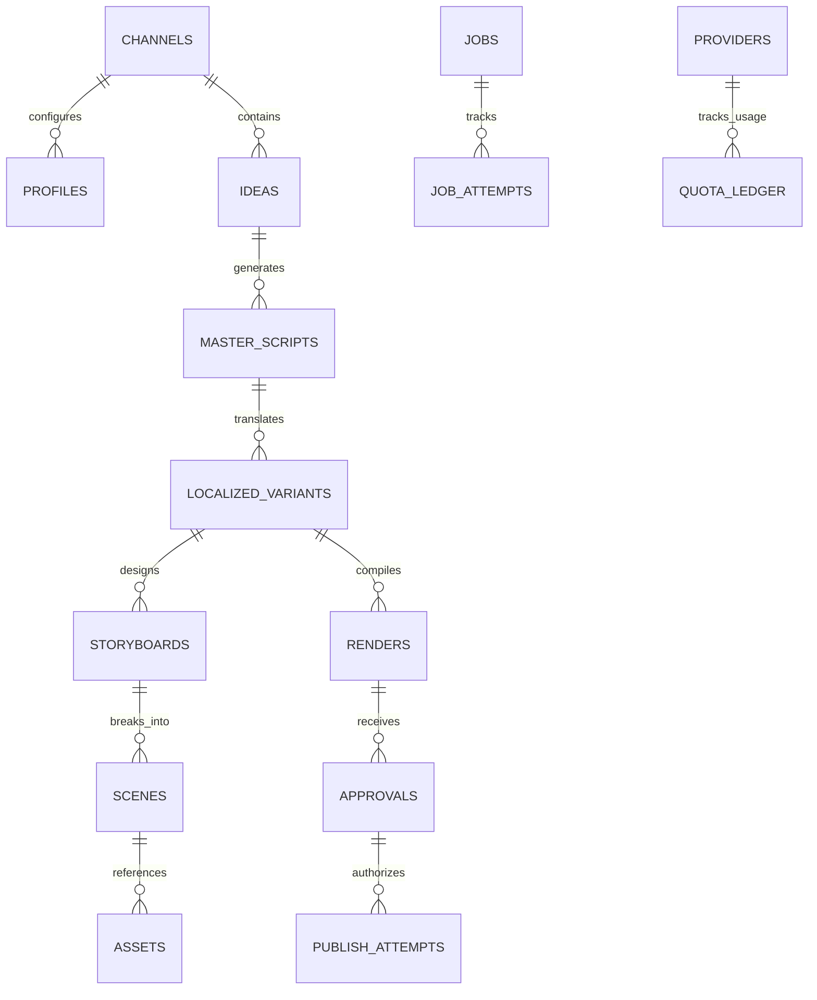
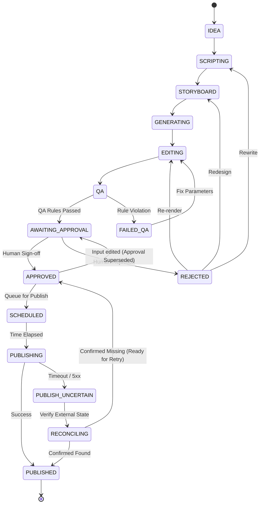
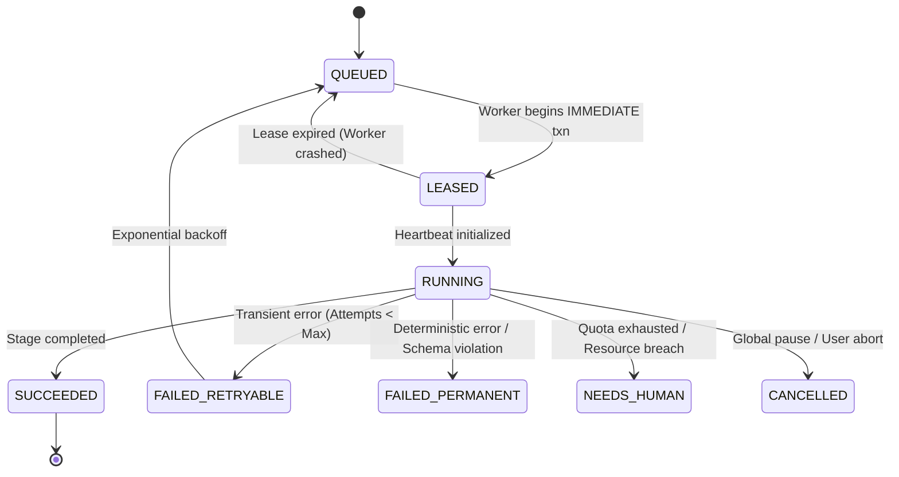

# Architecture Specification: AI Shorts & Reels Factory

**Version:** 1.0.0-draft  
**Status:** Under Review (Read-Only Phase)  
**Target Hardware:** Fedora 44, AMD Ryzen 5 8645HS, NVIDIA RTX 3050 (6 GB VRAM), 14 GiB RAM, 45 GB Disk  
**Host Binding:** `127.0.0.1` (Single-user local instance)

---

## 1. System Overview & Core Invariants

The **AI Shorts & Reels Factory** is a deterministic, self-hosted video production pipeline and review platform designed for automated generation of high-quality multilingual 9:16 vertical short-form videos (YouTube Shorts / Instagram Reels) with strict human-in-the-loop approval.

```
┌──────────────── Browser: Next.js UI (Static Export, 127.0.0.1 only) ───────────────┐
└────────────────────────────────────────▲────────────────────────────────────────────┘
                                         │ REST + SSE (Approvals require human session)
┌─────────────────────────────── FastAPI (API Process) ───────────────────────────────┐
│ • Policy Engine: State transitions, budgets, pause switch, approval verification    │
│ • Repositories: SQLite WAL persistence, outbox row creation, audit logging          │
│ • Static Assets: Serves compiled frontend from memory / disk at 127.0.0.1:8000      │
└────────────────────────────────────────▲────────────────────────────────────────────┘
                                         │ Atomic Job Lease / Heartbeat / Complete
┌──────────────────────── Worker Daemon (1 Process, 1 GPU slot) ──────────────────────┐
│ • Pipeline Runner: Stage dispatchers (Script → Storyboard → Assets → Render → QA)   │
│ • Video Engine: Declarative FFmpeg composition (stills + Ken Burns motion + audio)  │
│ • Rule-based QA: ffprobe technical verification, silence/black-frame detection      │
│ • Provider Adapters: LLM proposals, Image gen, TTS, manual-ingest, Publisher outbox│
└────────────────────────────────────────┬────────────────────────────────────────────┘
                                         │ Content-addressed storage (SHA-256)
                                         ▼
         data/media/<sha256> (Immutable assets)  ·  data/inbox/ (Manual Ingest)
```

### Core Invariants
1. **Zero Added Recurring Cost:** No provider categorized as `metered` is permitted to execute by default. Billing-enabled API keys are banned. All external quota consumption must go through ledger reservation.
2. **Immutable Approval Binding:** A video cannot be scheduled or published unless an active, non-superseded `approval` record exists matching the **exact SHA-256 checksum** of the final render output.
3. **Deterministic Enforcement vs. Probabilistic Proposals:** LLMs produce structured, schema-validated proposals only. The deterministic policy engine owns all workflow state transitions, quota reservations, and publishing decisions.
4. **Single-Worker Concurrency Control:** Only one background worker process runs, enforcing a strict limit of **one GPU-bound task at a time**.
5. **Fail-Closed Publishing & Outbox Pattern:** Direct database triggers block unauthorized publishing. Publishing attempts use an idempotent outbox pattern; uncertain network timeouts trigger reconciliation, never blind re-upload.
6. **Resource-Aware Guardrails:** The worker pauses job processing if available host RAM is `< 3.0 GiB` or free disk space is `< 10.0 GB`.

---

## 2. Process Topology

To preserve RAM on the 14 GiB host system, the runtime topology is condensed into two lightweight processes:

### Process 1: FastAPI API Server (`backend/app/api`)
- Runs with Uvicorn bound strictly to `127.0.0.1:8000`.
- Provides REST endpoints for idea management, review UI, manual asset uploads, and system administration.
- Provides Server-Sent Events (SSE) for real-time progress and job status updates.
- Serves the static export of the Next.js frontend (`frontend/out`) directly via FastAPI's `StaticFiles`.
- Enforces human session tokens for all approval and publishing mutation routes.

### Process 2: Worker Daemon (`backend/app/worker`)
- Single dedicated background Python process.
- Continuously polls the SQLite-backed job queue using `BEGIN IMMEDIATE` transactions to prevent duplicate leases.
- Maintains a heartbeat per leased job; automatically re-queues expired leases.
- Executes stage handlers:
  - `SCRIPT_GENERATE`: Generates structured master script proposal.
  - `SCRIPT_LOCALIZE`: Creates language/locale-specific script variants.
  - `STORYBOARD`: Breaks script into visual/audio scenes with Ken Burns camera instructions.
  - `STILLS_GENERATE`: Generates high-res visual stills per scene.
  - `AUDIO_SYNTHESIS`: Renders narration via Kokoro ONNX (or ingests manual audio).
  - `CAPTION_ALIGN`: Generates word-level timestamps and SSA/ASS styled subtitles.
  - `FFMPEG_COMPOSE`: Compiles scenes, motion, audio ducking, and subtitles into immutable MP4.
  - `TECHNICAL_QA`: Evaluates rule-based technical checks (resolution, duration, clipping, black frames).
  - `PUBLISH_OUTBOX`: Executes platform upload if approved.

---

## 3. Database & Storage Architecture

### SQLite in WAL Mode
- File: `data/factory.db`
- Journal Mode: `PRAGMA journal_mode=WAL;`
- Synchronous Mode: `PRAGMA synchronous=NORMAL;`
- Foreign Keys: `PRAGMA foreign_keys=ON;`
- Atomic Job Leasing: Handled via `BEGIN IMMEDIATE` transactions.

### Core Schema Tables



1. **`channels`**: Channel identifier, platform (YouTube, Instagram), active status, credentials reference in OS keyring.
2. **`profiles`**: Niche, audience style, visual themes, default duration, voice preferences, aspect ratio (default `9:16`).
3. **`ideas`**: Topic, premise, target audience, format template, status, lifecycle state.
4. **`master_scripts`**: Source narrative, hook, body scenes, call to action, language (default US English), version.
5. **`localized_variants`**: Target language (English, Hindi, Kannada, etc.), translated narration text, locale nuances, version.
6. **`storyboards`**: Scene sequence, visual prompts, transition styles, subtitle styling parameters, version.
7. **`scenes`**: Scene index, prompt, visual asset reference, duration, camera movement recipe (Ken Burns zoom/pan).
8. **`assets`**: Content-addressed media registry (`sha256`, byte size, mime type, provenance, source URL/path, license metadata).
9. **`renders`**: Immutable video artifact (`id`, `localized_variant_id`, `render_checksum`, `recipe_json`, `duration_seconds`, `resolution`, `file_path`, `qa_status`, `created_at`).
10. **`approvals`**: Human decision record (`id`, `render_id`, `render_checksum`, `reviewer`, `status`, `notes`, `created_at`, `superseded_at`).
11. **`publish_attempts`**: Publisher outbox records (`id`, `approval_id`, `render_id`, `platform`, `target_channel_id`, `status`, `external_id`, `retry_count`, `idempotency_key`, `created_at`).
12. **`jobs`**: Worker queue (`id`, `stage`, `payload_json`, `idempotency_key`, `status`, `lease_token`, `lease_expires_at`, `attempts`, `max_attempts`, `priority`).
13. **`quota_ledger`**: Provider resource tracking (`provider_id`, `cost_class`, `reserved_units`, `committed_units`, `period_start`, `period_end`).
14. **`audit_log`**: Tamper-evident ledger of all policy state transitions and human approvals.
15. **`settings`**: Key-value system configurations, including `global_pause` boolean and media retention limits.

### Hard Database Invariant: Trigger on `publish_attempts`
To ensure that no code or agent can bypass human approval:
```sql
CREATE TRIGGER enforce_valid_approval_before_publish
BEFORE INSERT ON publish_attempts
FOR EACH ROW
BEGIN
    SELECT CASE
        WHEN NOT EXISTS (
            SELECT 1 FROM approvals a
            JOIN renders r ON a.render_id = r.id
            WHERE a.id = NEW.approval_id
              AND a.render_id = NEW.render_id
              AND a.render_checksum = r.render_checksum
              AND a.status = 'APPROVED'
              AND a.superseded_at IS NULL
        )
        THEN RAISE(ABORT, 'Publish attempt rejected: Valid non-superseded approval matching render checksum required.')
    END;
END;
```

---

## 4. State Machines

### 4.1 Video Lifecycle State Machine



#### Material Edit & Invalidation Rule
If any input (script text, scene visual prompt, audio voice, subtitle styling, or transition duration) is modified after a render has been approved:
1. A new `render_v` row is created with a newly computed recipe hash and checksum.
2. The previous approval row is updated: `superseded_at = CURRENT_TIMESTAMP`.
3. The video state immediately drops back from `APPROVED` or `SCHEDULED` to `AWAITING_APPROVAL`.

### 4.2 Job Queue State Machine



### 4.3 Publish Attempt State Machine
- `PENDING`: Outbox row created by policy engine following explicit human approval.
- `IN_FLIGHT`: Publisher adapter initiates upload with platform-specific idempotency key.
- `SUCCESS`: Platform returns verified video ID and URL.
- `FAILED_RETRYABLE`: Network connection dropped prior to payload transmission.
- `UNCERTAIN`: Platform dropped connection during or immediately after chunked upload.
- `RECONCILING`: Worker queries platform API for recently uploaded media matching video title/checksum to confirm or refute upload without re-sending media bytes.

---

## 5. Composition & Rendering Engine (FFmpeg Baseline)

### Render Recipe Model
The entire rendering pipeline is governed by a deterministic JSON recipe:
```json
{
  "version": 1,
  "output": {
    "format": "mp4",
    "width": 1080,
    "height": 1920,
    "fps": 30,
    "video_codec": "libx264",
    "audio_codec": "aac",
    "pixel_format": "yuv420p"
  },
  "audio": {
    "narration_asset_sha256": "...",
    "background_music_asset_sha256": "...",
    "ducking_db": -18.0
  },
  "subtitles": {
    "ass_asset_sha256": "...",
    "font_family": "Montserrat",
    "font_size": 18
  },
  "scenes": [
    {
      "index": 0,
      "still_asset_sha256": "...",
      "duration": 4.5,
      "motion": {
        "type": "ken_burns",
        "zoom_start": 1.0,
        "zoom_end": 1.15,
        "pan_direction": "center_to_top"
      },
      "transition": { "type": "fade", "duration": 0.3 }
    }
  ]
}
```

### Deterministic Render Checksum
`render_checksum = SHA-256(canonical_json(recipe) + narration_bytes_hash + still_assets_hashes + subtitle_bytes_hash)`

### Rule-Based Technical QA
Prior to presenting a render for human approval, the worker executes automated ffprobe checks:
1. **Dimensions:** Exactly 1080×1920 (9:16 aspect ratio).
2. **Duration:** Between 15.0 and 59.5 seconds (Shorts/Reels strict limit).
3. **Audio Normalization:** Integrated loudness strictly compliant with EBU R128 (-14 to -16 LUFS).
4. **Visual Health:** Black-frame detection (`blackdetect`) and freeze-frame detection (`freezedetect`).
5. **Caption Legibility:** Verify subtitles do not overlap safety margin zones (top header and bottom UI overlay areas).

---

## 6. Provider Registry & Quota Ledger

Every service integration adheres to a strict cost contract:

```yaml
providers:
  llm_planner:
    type: "gemini_free"
    cost_class: "free_quota"   # AI Studio free tier text models only
    daily_request_limit: 1500
    rpm_limit: 15
  
  tts_narrator:
    type: "kokoro_onnx"
    cost_class: "free_local"   # Runs locally on CPU
    supported_languages: ["en", "hi"]

  tts_manual_ingest:
    type: "manual_audio"
    cost_class: "manual"       # Ingests user-provided audio for Kannada, Tamil, etc.

  visual_stills:
    type: "mock_image"         # Phase 1-2 baseline, replaced in Phase 3
    cost_class: "free_local"

  video_clips:
    type: "manual_inbox"
    cost_class: "manual"       # User drops Flow clips in data/inbox/
    credit_estimate_per_clip: 10 # Tracks estimated Google Flow credits

  youtube_publisher:
    type: "youtube_data_api_v3"
    cost_class: "free_quota"
    quota_cost_per_upload: 1600
    daily_quota_limit: 10000
```

### Guardrail on Startup
If any provider configuration specifies `cost_class: metered` without explicit command-line override and financial cap, the application will **refuse to boot**.
