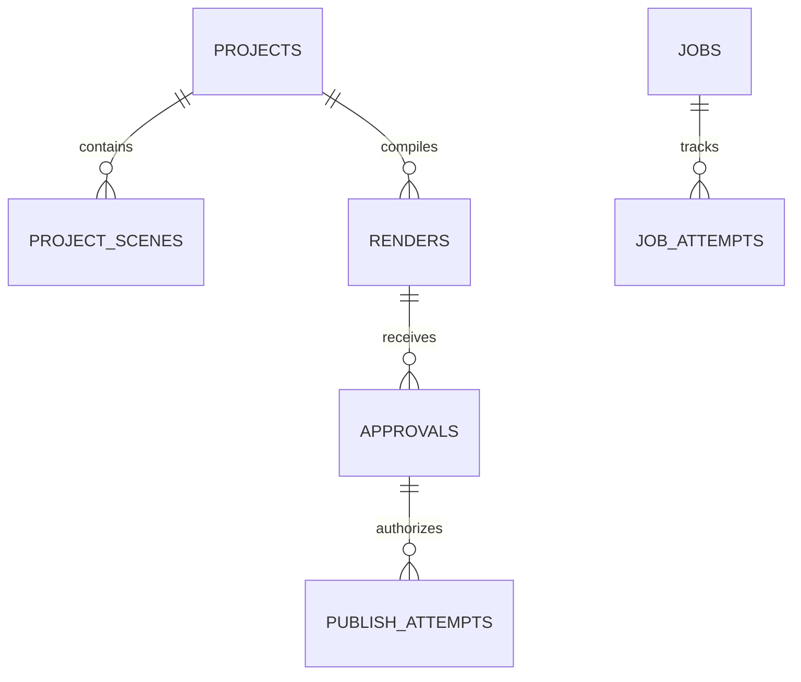

# Architecture Specification: AI Shorts & Reels Factory

**Version:** 1.1.0 (Phase 2A Baseline)  
**Status:** Implemented & Verified  
**Target Hardware:** Fedora 44, AMD Ryzen 5 8645HS, NVIDIA RTX 3050 (6 GB VRAM), 14 GiB RAM, 44 GB Free Disk  
**Host Binding:** `127.0.0.1` (Single-user local instance)

---

## 1. System Overview & Core Invariants

The **AI Shorts & Reels Factory** is a deterministic, self-hosted video production pipeline and review platform designed for automated generation of high-quality multilingual 9:16 vertical short-form videos (YouTube Shorts / Instagram Reels) with strict human-in-the-loop approval.

```
┌──────────────── Browser: Next.js UI (Static Export, 127.0.0.1 only) ───────────────┐
│ • Project Manager · Storyboard Editor · Asset Ingest · MP4 Preview · Approval Gate │
└────────────────────────────────────────▲────────────────────────────────────────────┘
                                         │ REST + SSE (Approvals require human session)
┌─────────────────────────────── FastAPI (API Process) ───────────────────────────────┐
│ • Policy Engine: State transitions, budgets, pause switch, approval verification    │
│ • Repositories: SQLite WAL persistence, outbox row creation, audit logging          │
│ • Static Assets: Serves compiled frontend from memory / disk at 127.0.0.1:8000      │
└────────────────────────────────────────▲────────────────────────────────────────────┘
                                         │ Atomic Job Lease / Heartbeat / Complete
┌──────────────────────── Worker Daemon (1 Process, 1 GPU slot) ──────────────────────┐
│ • Pipeline Runner: Stage dispatchers (Script → Storyboard → Assets → Render → QA)   │
│ • Video Engine: Declarative FFmpeg composition (stills + ASS subtitles + AAC audio) │
│ • Rule-based QA: ffprobe technical verification, 9:16 resolution, duration, audio   │
│ • Provider Adapters: LLM proposals, Image gen, TTS, manual-ingest, Publisher outbox│
└────────────────────────────────────────┬────────────────────────────────────────────┘
                                         │ Content-addressed storage (SHA-256)
                                         ▼
         data/media/<sha256> (Immutable assets)  ·  data/inbox/ (Manual Ingest)
```

### Core Invariants
1. **Zero Added Recurring Cost:** No provider categorized as `metered` is permitted to execute by default. Billing-enabled API keys are banned. All external quota consumption must go through ledger reservation.
2. **Immutable Approval Binding:** A video cannot be scheduled or published unless an active, non-superseded `approval` record exists matching the **exact SHA-256 checksum** of the final render output.
3. **Deterministic Enforcement vs. Probabilistic Proposals:** LLMs produce structured, schema-validated proposals only. The deterministic policy engine owns all workflow state transitions, quota reservations, and publishing decisions.
4. **Single-Worker Concurrency Control:** Only one background worker process runs, enforcing a strict limit of **one GPU/CPU-bound render task at a time**.
5. **Fail-Closed Publishing & Outbox Pattern:** Direct database triggers block unauthorized publishing. Publishing attempts use an idempotent outbox pattern; uncertain network timeouts trigger reconciliation, never blind re-upload.
6. **Resource-Aware Guardrails:** The worker pauses job processing if available host RAM is `< 3.0 GiB` or free disk space is `< 10.0 GB`.

---

## 2. Process Topology

To preserve RAM on the 14 GiB host system, the runtime topology is condensed into two lightweight processes:

### Process 1: FastAPI API Server (`backend/app/api`)
- Runs with Uvicorn bound strictly to `127.0.0.1:8000`.
- Provides REST endpoints for project management, storyboard editing, asset uploads, review UI, and system administration.
- Serves the static export of the Next.js frontend (`frontend/out`) directly via FastAPI's `StaticFiles`.
- Enforces human session tokens for all approval and publishing mutation routes.

### Process 2: Worker Daemon (`backend/app/worker`)
- Single dedicated background Python process.
- Continuously polls the SQLite-backed job queue using `BEGIN IMMEDIATE` transactions to prevent duplicate leases.
- Maintains a heartbeat per leased job; automatically re-queues expired leases.
- Executes stage handlers:
  - `RENDER_PROJECT`: Generates default scene backgrounds if missing, formats ASS subtitles, invokes FFmpeg composition subprocess, validates via `TechnicalQA`, creates immutable render row, and marks project `AWAITING_APPROVAL`.
  - `MOCK_SCRIPT`: Generates structured master script proposal.
  - `MOCK_AUDIO`: Generates mock narration audio.
  - `MOCK_STILLS`: Generates synthetic still images.

---

## 3. Database & Storage Architecture

### SQLite in WAL Mode
- File: `data/factory.db`
- Journal Mode: `PRAGMA journal_mode=WAL;`
- Synchronous Mode: `PRAGMA synchronous=NORMAL;`
- Foreign Keys: `PRAGMA foreign_keys=ON;`
- Atomic Job Leasing: Handled via `BEGIN IMMEDIATE` transactions.

### Core Schema Tables



1. **`projects`**: Unique project record (`id`, `title`, `topic`, `target_audience`, `language`, `target_duration`, `content_format`, `narration_mode`, `narration_audio_path`, `status`, `current_render_id`, `created_at`, `updated_at`).
2. **`project_scenes`**: Granular scene data (`id`, `project_id`, `scene_index`, `scene_title`, `narration_text`, `caption_text`, `duration_seconds`, `visual_asset_path`, `created_at`).
3. **`renders`**: Immutable video artifact (`id`, `project_id`, `localized_variant_id`, `render_checksum`, `recipe_json`, `duration_seconds`, `resolution`, `file_path`, `qa_status`, `created_at`).
4. **`approvals`**: Human decision record (`id`, `render_id`, `render_checksum`, `reviewer`, `status`, `notes`, `created_at`, `superseded_at`).
5. **`publish_attempts`**: Publisher outbox records (`id`, `approval_id`, `render_id`, `platform`, `target_channel_id`, `status`, `external_id`, `retry_count`, `idempotency_key`, `created_at`).
6. **`jobs`**: Worker queue (`id`, `stage`, `payload_json`, `idempotency_key`, `status`, `lease_token`, `lease_expires_at`, `attempts`, `max_attempts`, `priority`).
7. **`audit_log`**: Tamper-evident ledger of all policy state transitions and human approvals.
8. **`settings`**: Key-value system configurations, including `global_pause` boolean and media retention limits.

### Hard Database Invariant: Trigger on `publish_attempts`
To ensure that no code or agent can bypass human approval:
```sql
CREATE TRIGGER IF NOT EXISTS enforce_valid_approval_before_publish
BEFORE INSERT ON publish_attempts
FOR EACH ROW
BEGIN
    SELECT CASE
        WHEN NOT EXISTS (
            SELECT 1 FROM approvals a
            JOIN renders r ON a.render_id = r.id
            WHERE a.id = NEW.approval_id
              AND a.render_id = NEW.render_id
              AND a.render_checksum = r.render_checksum
              AND a.status = 'APPROVED'
              AND a.superseded_at IS NULL
        )
        THEN RAISE(ABORT, 'Publish attempt rejected: Valid non-superseded approval matching render checksum required.')
    END;
END;
```

---

## 4. Video Composition & QA Pipeline

```
  Storyboard Scenes (durations + titles + captions)
          │
          ├────────────────────────┐
          ▼                        ▼
  Visual Assets (PNG/JPG)   Subtitles Generator (.ass)
          │                        │
          └───────────┬────────────┘
                      ▼
            FFmpeg CLI via Subprocess
                      │
                      ▼
         Web-Optimized MP4 (H.264 / AAC)
                      │
                      ▼
            ffprobe Technical QA
          (Width, Height, Duration, Codec)
                      │
                      ▼
       SHA-256 Checksum Calculation & Store
```

### Narration & Audio Subsystem

```
                      BaseNarrationAdapter (backend/app/media/narration.py)
                                      │
         ┌────────────────────────────┼────────────────────────────┐
         ▼                            ▼                            ▼
SilentNarrationAdapter       ManualAudioAdapter           LocalTTSAdapter (Phase 2B)
(Synthetic stereo AAC)      (ffprobe verification)       (Kokoro-82M ONNX on CPU)
                                                         • English (af_bella, etc.)
                                                         • Hindi (hf_alpha, etc.)
                                                         • Speed: 0.5x – 2.0x
```

- **`SilentNarrationAdapter`**: Generates a synchronized silent stereo AAC audio track matching exact scene durations.
- **`ManualAudioAdapter`**: Verifies user-uploaded voiceovers (WAV/MP3) via `ffprobe` for duration, channel count, and integrity. Guarantees full support for regional Indian languages (Kannada, Tamil, Telugu) without AI dependencies.
- **`LocalTTSAdapter` (Phase 2B)**: Executes Kokoro-82M ONNX inference purely on CPU. Generates 24 kHz mono audio, converted by FFmpeg into AAC stereo. Incorporates audio SHA-256 checksum into render recipe. Fail-closed on missing models; zero paid cloud fallbacks.

### Composition Engine
- Direct argument-list invocation of `/usr/bin/ffmpeg` via Python standard library `subprocess`.
- Default canvas: 720×1280 (9:16 vertical), configurable to 1080×1920.
- Video codec: `libx264` (CPU software encoding, fast preset, crf 23, faststart enabled).
- Audio codec: `aac` 128k stereo.
- Subtitle burn-in: SubStation Alpha (ASS) filter with bottom margin safety zone (margin_v ≥ 150px) preventing UI collision on YouTube Shorts and Instagram Reels.

---

## 5. Research Agent, FactLedger & Script Intelligence Subsystem (Stage 2)

```
Topic + Audience
       │
       ▼
BaseSearchAdapter (backend/app/research/search_adapters.py)
  ├── DDGSSearchAdapter (DuckDuckGo via ddgs; zero API keys, rate-limited)
  └── MockSearchAdapter (Deterministic fixtures for offline testing)
       │ Candidate URLs
       ▼
BaseExtractionAdapter (backend/app/research/extraction_adapters.py)
  ├── HTTPTextExtractionAdapter (httpx + lxml; <25 MB RAM, 0 VRAM, clean markdown/text)
  └── MockExtractionAdapter (Simulated document text & titles)
       │ Full Extracted Text
       ▼
FactLedgerManager (backend/app/research/fact_ledger.py)
  ├── Exact quote provenance verification (prevents hallucinated evidence)
  ├── Status classification: VERIFIED | UNVERIFIED | INSUFFICIENT_EVIDENCE
  └── Duplicate claim suppression via word-overlap similarity (>70% overlap)
       │ Verified Claims + Source IDs
       ▼
Narrative Architect (backend/app/research/narrative_architect.py)
  ├── Archetypes: CURIOSITY_GAP | HISTORICAL_MICRO_EPIC | DISCONFIRMATION_JOURNEY | SCALE_SHOCK
  └── Scene beat synthesis bound to supporting claim IDs
       │ Script Proposal
       ▼
DeterministicScriptValidator (backend/app/research/validator.py)
  ├── Flags missing source links and unverified claims
  ├── Cadence analysis: Target 2.2 – 2.8 words/second (warns if rushed >3.2 WPS or sluggish <1.8 WPS)
  ├── Hook potency check: Evaluates opening 3 seconds for intrigue / assertion
  └── Generates ValidationReportModel (is_valid, score, warnings, errors)
       │
       ▼
Human Review in Next.js Dashboard (FactLedger panel, claim chips, proposal overrides)
```

### FactLedger Core Invariants
1. **Search Snippet Exclusion:** Search engine summary snippets are strictly forbidden from serving as independently verified evidence. A claim can only be assigned `VERIFIED` status after full document body extraction and verbatim quote verification.
2. **Explicit Uncertainty:** Unverified claims, extraction timeouts, or 404 responses are recorded explicitly as `UNVERIFIED` or `INSUFFICIENT_EVIDENCE` with detailed uncertainty rationale.
3. **Database Relational Binding:** Fact sources (`fact_sources`) and claims (`fact_claims`) are content-addressed and relationally linked to projects, proposals, and scene beats (`supporting_claim_ids`).
4. **Deterministic Gatekeeper:** The `DeterministicScriptValidator` acts as an automated editorial gatekeeper before human approval, blocking hallucinated claim IDs and highlighting pacing bottlenecks.

---

## 6. Dynamic Visual Assembly, Motion, Audio Hierarchy & Multi-Tier QA (Stage 3)

```
Scene Beats + Fact Claims
         │
         ▼
CompositeVisualResolver (backend/app/media/visual_adapters.py)
  ├── Priority 1: UserProvidedAssetAdapter (Uploaded & validated)
  ├── Priority 2: WikimediaNasaAssetAdapter (API verified: CC-BY, CC0, NASA Open Media)
  ├── Priority 3: ProceduralGraphicAdapter (Thematic scientific vector infographics)
  └── Priority 4: Default Solid Gradient (Deterministic fallback)
         │ Persisted to asset_provenance table
         ▼
FFmpeg Composer with Ken Burns Engine (backend/app/media/ffmpeg_composer.py)
  ├── Bounded Zoom & Pan (zoom_in, zoom_out, pan_left, pan_right, tilt_up, tilt_down)
  ├── Resolution: 1080x1920 (Benchmark) & 720x1280 (Fast Draft) @ 30 fps
  └── Subtitle Burn-in (backend/app/media/subtitles.py)
        • Phrase-level rhythmic chunking (2-4 words)
        • Mobile safe-zone margins (bottom margin >= 240px for 1080p)
        • High-contrast bold styling with black outline and active word highlight
         │
         ▼
Audio Mixer & Sidechain Ducking (backend/app/media/audio_mixer.py)
  ├── Input 0: Speech Narration (Kokoro-82M ONNX or Manual Voiceover)
  ├── Input 1: Background Music (User track or procedural ambient bed)
  ├── Sidechain Compression: Duck music by ~14 to 18 dB when speech occurs
  └── EBU R128 Loudness Normalization: target -16.0 LUFS, true peak <= -1.5 dBTP
         │
         ▼
Dual-Tier Quality Assurance
  ├── Technical QA (backend/app/media/qa.py):
  │     • 9:16 aspect ratio & dimensions (1080x1920)
  │     • Black-frame detection (blackdetect d=1.5s)
  │     • Freeze-frame detection (freezedetect d=3.0s)
  │     • True-peak clipping (< -0.5 dBFS) & LUFS compliance
  └── Editorial QA (backend/app/media/editorial_qa.py):
        • Opening hook potency & word count in critical first 3 seconds
        • Pacing & spoken cadence per scene (target 2.2 - 2.8 WPS)
        • Visual asset diversity & claim alignment
        • Closing philosophical / takeaway payoff
```

### Stage 3 Invariants & Operational Rules
1. **Asset Attribution & Rights Persistence:** Every external visual or audio asset must record source URL, creator/author, verified license name, and attribution string in `asset_provenance`.
2. **Audio Dominance:** Spoken narration is strictly prioritized; background music is automatically ducked under speech using sidechain compression and normalized to EBU R128 (-16.0 LUFS). Voice-only rendering is fully supported without music.
3. **Bounded Visual Motion:** Motion filters are strictly bounded (zoom factor 1.0 to 1.12x) to maintain visual clarity and prevent disorientation or pixelation.
4. **Independent Quality Tiers:** A technical pass from `TechnicalQA` does not certify editorial quality; `EditorialQA` operates as an independent audit scoring retention, pacing, and hook potency.

---

## 7. Hybrid High-Craft Visual Engine (Stage 5)

```
Scene Beats + Fact Claims
         │
         ▼
SceneVisualSelector (backend/app/media/visual_selector.py)
  ├── 1. Classify Modality:
  │     • PROCEDURAL: Formulas, equations, NIST atomic clock lab measurements
  │     • VIDEO: Curving Earth from orbit, satellites, astronomy, space phenomena
  │     • IMAGE_KEN_BURNS: Conceptual scenes best depicted by curated stills
  │
  ├── 2. Video Ingest Layer (backend/app/media/video_adapters.py):
  │     • NASAVideoAdapter: NASA Image & Video Library (images-api.nasa.gov)
  │     • WikimediaVideoAdapter: Wikimedia Commons API (commons.wikimedia.org)
  │     • Guardrails: Max 35 MB, 10s timeout, video/mp4/webm MIME check, SHA-256 hash
  │     • Rights Verification: Public Domain, CC0, CC-BY, CC-BY-SA only; rejects NC/ND
  │
  ├── 3. Video Reframer (backend/app/media/reframing.py):
  │     • Standardizes landscape/arbitrary footage to 1080x1920 30fps vertical MP4
  │     • Strips original audio (-an)
  │     • Configurable crop anchors: center, top, bottom
  │
  └── 4. Fail-Closed Fallback Cascade:
        • Authentic Video failure -> Procedural Infographic -> Curated Image -> Gradient
         │
         ▼
FFmpeg Composer with Duration-Preserving Transitions (backend/app/media/ffmpeg_composer.py)
  ├── Clip Handle Extensions: Scenes 0..N-2 extended by transition duration T (default 0.5s)
  ├── Overlap Offset Arithmetic: Offset_k = Sum_{j=0}^{k} D_j
  │     Result: Total composite duration exactly equals Sum D_j (0s shrinkage, 0s drift)
  ├── Short-Scene Fallback: If any D_i < 2*T, falls back to clean jump cut (concat)
  └── Subtitle Burn-in & AAC Audio remux with -movflags +faststart
```

### Stage 5 Invariants & Operational Rules
1. **Zero Runtime Diffusion:** No generative diffusion models or GPU ML frameworks are invoked during rendering. All dynamic motion is sourced via authenticated open APIs or programmatic vector graphics.
2. **Handle-Extended Cross-Dissolves:** When cross-dissolve transitions (`xfade`) are enabled, earlier scene segments are extracted/generated with length $D_i + T$. The overlap occurs across the extended handle, completely eliminating speech cutoff and caption drift.
3. **Strict License & Attribution Enforcement:** Downloaded video assets must be verified as open (Public Domain, CC0, CC-BY, CC-BY-SA). Assets with non-commercial, no-derivatives, or third-party copyright claims in metadata are immediately rejected.
4. **Deterministic Reframing:** Video reframing is executed via pure FFmpeg scaling and cropping to exact 1080x1920 dimensions without introducing aspect-ratio distortion or audio contamination.

---

## 8. Secure YouTube OAuth and Private Upload Architecture (Stage 6)

```
Human Approval (approvals table) + Checksum Match
                   │
                   ▼
YouTubeUploader (backend/app/publishing/youtube_uploader.py)
  ├── 1. Pre-Upload Safety Verification:
  │     • Render exists and Technical QA == 'PASSED'
  │     • Re-computes on-disk SHA-256 and verifies exact match with render record
  │     • Validates active, non-superseded human approval (superseded_at IS NULL)
  │     • Strict Boundary: privacyStatus == 'private' (public/unlisted rejected)
  │     • Enforces DB Trigger: enforce_valid_approval_before_publish
  │
  ├── 2. Resumable Upload (MediaFileUpload chunksize=1MB):
  │     • Next chunk loop with exponential backoff for transient 5xx errors
  │     • Daily quota exceeded (403) and revoked token handling
  │     • Attributed description generation (FactLedger source credits)
  │     • Persists publish_attempts record with external_id (YouTube Video ID)
  │
  └── 3. Idempotency & Deduplication:
        • Deterministic key: yt_up_{render_id}_{checksum[:12]}
        • Returns existing confirmed video ID without duplicate uploads
                   │
                   ▼
YouTubeOAuthManager (backend/app/publishing/youtube_oauth.py)
  ├── 1. CSRF State Validation:
  │     • Cryptographically random token (secrets.token_urlsafe(32))
  │     • Persisted in oauth_states table with 10-minute expiry
  │     • Enforces single-use consumption
  │
  ├── 2. Token Lifecycle & Offline Access:
  │     • Requests access_type="offline" & prompt="consent" for refresh token
  │     • Automatic token refresh when creds.expired
  │     • Required scope: https://www.googleapis.com/auth/youtube.upload
  │
  └── 3. Restricted Secret Storage (backend/app/publishing/secrets.py):
        • data/secrets/youtube_credentials.json (0600 file permissions)
        • data/secrets/client_secret.json (0600 file permissions)
        • .gitignore protects all secret files from version control
        • Strict redaction: tokens & secrets never exposed in logs or APIs
```

### Stage 6 Invariants & Operational Rules
1. **Strict Private Publishing Boundary:** In Stage 6, initial uploads MUST be strictly `private`. Any attempt to request `public` or `unlisted` status is blocked before any API call is made. No automatic, scheduled, or unreviewed publishing is permitted.
2. **Database Trigger Guardrail:** The SQLite database trigger `enforce_valid_approval_before_publish` aborts any INSERT into `publish_attempts` unless an active, non-superseded approval exists matching the exact render checksum.
3. **On-Disk Checksum Verification:** Before initiating an upload, the uploader re-hashes the video file on disk. If the calculated SHA-256 does not match the immutable render record, the upload is aborted to protect against accidental post-render file modification.
4. **Zero Secret Leakage:** Client secrets, authorization codes, access tokens, and refresh tokens are strictly excluded from Git, database tables, API responses, and application logs. File permissions are restricted to `0600` (read/write only by file owner).

