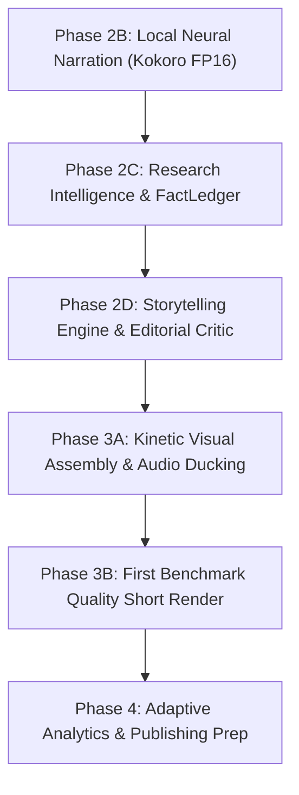

# Quality-First Adaptive AI Shorts Factory: Strategic Roadmap & Architecture

**Document Version:** 2.0.0-STRATEGIC  
**Status:** Read-Only Strategic Evaluation & Roadmap  
**Target Hardware:** Fedora Linux 44, AMD Ryzen 5 8645HS (6C/12T), NVIDIA RTX 3050 Laptop GPU (6 GB VRAM), 14 GiB RAM, 44 GB Free NVMe Disk  
**Operating Mode:** Local-first, zero recurring API cost, human-in-the-loop approval, single worker process

---

## Executive Summary: The Quality Transition

Phase 2A established our deterministic mechanical baseline: an end-to-end pipeline rendering an immutable 720×1280 MP4 in 1.74 seconds with database triggers and human approval gates. However, flat background slides, robotic narration, generic templates, and bullet-point summaries are commercial dead-ends on short-form platforms (YouTube Shorts and Instagram Reels).

This document establishes the architecture for an **intelligent, adaptive AI content agent**. The factory transitions from an "FFmpeg batch processor" into a **research-backed storytelling engine** that:
1. Researches verifiable scientific, historical, and technical facts with source provenance.
2. Crafts dramatic narrative arcs (hooks, curiosity loops, evidence reveals, payoffs) tuned for speech.
3. Assembles dynamic visual compositions (public domain historical archives, procedural data diagrams, kinetic typography, Ken Burns motion).
4. Delivers high-fidelity neural narration with word-level synced captions and audio ducking.
5. Employs dual-layer Quality Assurance: automated technical enforcement plus editorial critique.
6. Adapts iteratively by learning which story structures and pacing deliver authentic viewer retention.

```
┌────────────────────────────────────────────────────────────────────────────────────────┐
│                        ADAPTIVE CONTENT INTELLIGENCE LAYER                             │
│  • Historical Performance Tracking  • Bayesian Metric Normalization  • Topic Proposals │
└───────────────────────────────────────────▲────────────────────────────────────────────┘
                                            │ Feeds verified angles
┌───────────────────────────────────────────┴────────────────────────────────────────────┐
│                         RESEARCH & FACT LEDGER SUBSYSTEM                               │
│  • Niche Intelligence  • Multi-Source Extraction (DuckDuckGo / Crawl4AI / Openverse)   │
│  • Claim & Source Provenance (FactLedger: URL, timestamp, quote, uncertainty score)    │
└───────────────────────────────────────────▲────────────────────────────────────────────┘
                                            │ Verified claims & quotes
┌───────────────────────────────────────────┴────────────────────────────────────────────┐
│                         STORYTELLING & EDITORIAL ENGINE                                │
│  • Narrative Archetype Router (Curiosity Gap, Micro-Epic, Myth Buster, Scale Journey)   │
│  • Spoken-Ear Cadence Optimizer  • Beat Map (2.5–4.0s visual tempo)                    │
│  • Automated Editorial Critic (Hook test, Information density, Ending payoff audit)    │
└───────────────────────────────────────────▲────────────────────────────────────────────┘
                                            │ Validated Storyboard & Beat Map
┌───────────────────────────────────────────┴────────────────────────────────────────────┐
│                         MULTI-TRACK MEDIA SYNTHESIZER                                  │
│  ┌───────────────────────┐  ┌───────────────────────┐  ┌────────────────────────────┐  │
│  │ Visual Assembly       │  │ Neural Speech Engine  │  │ Dynamic Audio Mixing       │  │
│  │ • NASA / Wikimedia    │  │ • Kokoro-82M FP16     │  │ • EBU R128 (-15 LUFS)      │  │
│  │ • Procedural Diagrams │  │ • Word Timestamps     │  │ • Sidechain Music Ducking  │  │
│  │ • Ken Burns Pan/Zoom  │  │ • Phonetic Dict       │  │ • Kinetic ASS Subtitles    │  │
│  └───────────┬───────────┘  └───────────┬───────────┘  └─────────────┬──────────────┘  │
└──────────────┼──────────────────────────┼────────────────────────────┼─────────────────┘
               └──────────────────────────┼────────────────────────────┘
                                          ▼
┌────────────────────────────────────────────────────────────────────────────────────────┐
│                   DETERMINISTIC COMPOSITION & DUAL-LAYER QA                            │
│  • Argument-List FFmpeg Subprocess (Web-Optimized 1080×1920 / 720×1280 H.264/AAC MP4)  │
│  • Layer 1: Technical QA (ffprobe, clipping, blackdetect, duration, aspect ratio)       │
│  • Layer 2: Editorial QA (pacing audit, caption safety, claim verification checklist)   │
│  • SHA-256 Checksum Calculation → Immutable Render Record                              │
└───────────────────────────────────────────▲────────────────────────────────────────────┘
                                            │ Immutable checksum binding
┌───────────────────────────────────────────┴────────────────────────────────────────────┐
│                     MISSION CONTROL REVIEW & APPROVAL GATE                             │
│  • In-Browser Video Player • Fact & Source Audit Panel • Checksum-Locked Approval      │
│  • Database Trigger: publish_attempts rejected without active non-superseded approval  │
└────────────────────────────────────────────────────────────────────────────────────────┘
```

---

## 1. Research & Topic Intelligence Architecture

A high-performing Short begins with truth and novelty, not recycled clichés. The research engine separates **topic discovery** from **claim verification**.

### 1.1 Discovery & Provenance Engine
- **Topic Discovery Streams:**
  - *Timely Topics:* Fast-moving breakthroughs, recent space/nature discoveries, breaking historical releases.
  - *Evergreen Topics:* Perennially counterintuitive phenomena, foundational principles, solved mysteries.
- **Source Provenance Contract (`FactLedger`):**
  Every generated script references a structured `FactLedger` stored in SQLite:
  ```json
  {
    "claim_id": "fact_01",
    "assertion": "Clocks at sea level tick slower than clocks on Mt. Everest by ~30 microseconds per year.",
    "source_url": "https://nvlpubs.nist.gov/nistpubs/Legacy/SP/nistspecialpublication300v3.pdf",
    "source_title": "NIST Precision Measurement Special Publication",
    "published_year": 2021,
    "quote_snippet": "The gravitational time dilation difference equates to approximately 30 microseconds annually across 8,848 meters.",
    "uncertainty_status": "VERIFIED_PRIMARY",
    "license_notes": "US Government Public Domain"
  }
  ```
- **Rule Against Hallucination:** The script generator is banned from citing unverified numbers or attributions. If a claim lacks a `FactLedger` entry, the critique layer rejects the script draft.

### 1.2 Open-Source Scraping & Search Candidates

| Tool / Source | License | Capabilities & Role | Local / Free Operation | Memory / VRAM | Limitation / Decision |
| :--- | :--- | :--- | :--- | :--- | :--- |
| **`duckduckgo-search`** | MIT | Direct meta-search via DDG Lite/HTML API. Discovers URLs and headlines without API keys. | 100% Free, no account needed | ~30 MB RAM, 0 VRAM | **Adopt immediately**: Lightest local search discovery layer. |
| **`Crawl4AI`** | Apache-2.0 | High-speed headless Chromium scraper extracting clean, LLM-ready markdown from web pages. | 100% Local open-source | ~800 MB RAM (Chromium instance) | **Adopt for deep scraping**: Use on-demand when a primary source URL needs claim verification. Run headlessly with auto-kill. |
| **`Wikimedia API`** | CC-BY-SA | Direct search across Wikipedia articles, verified lead paragraphs, references, and citations. | 100% Free, no keys required | ~10 MB RAM | **Adopt**: Ideal for background context and historical dates. |
| **`SearXNG`** | AGPLv3 | Self-hosted metasearch aggregating Google/Bing/ArXiv. | Local Docker service | ~350 MB RAM | **Defer**: Running an extra background service is unnecessary when `duckduckgo-search` + `Crawl4AI` suffice. |

---

## 2. Scriptwriting Intelligence: Storytelling Over Summaries

Shorts fail when they resemble textbooks. Viewer retention curves show that drops occur in the first 2 seconds (hook failure) and around second 10 (pacing lull).

### 2.1 Narrative Archetypes
The system implements four distinct, battle-tested story templates:

```
1. CURIOSITY GAP (Mystery → False Assumption → Deep Truth → Mind-Bending Payoff)
   • 0–3s: "You think your GPS tracks your location using satellites. That's half the truth."
   • 3–10s: Reveal the complication (satellite clocks tick 38 microseconds faster every single day).
   • 10–20s: The mechanism (Einstein's general relativity: less gravity means faster time).
   • 20–28s: The payoff (without software correcting for relativity, Google Maps would drift 11 kilometers daily).

2. THE HISTORICAL MICRO-EPIC (Human Stake → Crisis → Turning Point → Modern Legacy)
   • Focuses on a single decision, blunder, or breakthrough with specific names and stakes.

3. THE DISCONFIRMATION JOURNEY (Common Myth → Critical Counter-Evidence → Physical Reality)
   • Targets deeply held intuitive fallacies in biology, physics, or everyday technology.

4. THE SCALE SHOCK (Familiar Object → Exponential Leap → Cosmic Perspective)
   • Anchors in a recognizable physical scale before taking the viewer into atomic or astronomical realms.
```

### 2.2 Writing for the Ear (Acoustic Script Constraints)
- **Word Budget:** 2.4 to 2.7 words per second (130–150 words per minute). A 30-second Short must contain between 68 and 80 spoken words.
- **Phonetic Cadence:** Maximum sentence length is 14 words. Complex clauses are split into rhythmic declarations.
- **Punctuation Beats:** Commas and ellipses (`...`) are explicitly positioned to guide the neural TTS engine's breathing pauses.
- **Visual-Auditory Sync:** Every spoken sentence is accompanied by an explicit visual action directive.

---

## 3. Visual Quality & Motion Graphics

### 3.1 Visual Asset Sourcing Strategy
To replace flat solid backgrounds with compelling vertical video, the factory deploys a three-tier asset hierarchy:

```
TIER 1: Public Domain & Open Access Archives (Primary Historical/Scientific Visuals)
  • NASA Image & Video Library (CC0 / US Public Domain): Hubble/JWST, planetary surfaces, launch telemetry.
  • Wikimedia Commons (CC-BY / Public Domain): High-resolution archival photos, historical manuscripts, microscopy.
  • European Southern Observatory (ESO / CC-BY 4.0): Astronomical animations and space captures.

TIER 2: Procedural Data Diagrams & Animated Overlays (Conceptual Clarity)
  • Matplotlib / Seaborn / Cairo rendered directly to vertical 1080×1920 transparent PNGs.
  • Procedural animated kinetic text banners, neon callout boxes, and comparison split-screens via FFmpeg filtergraphs.

TIER 3: Permissive B-Roll & User-Provided Ingest (Cinematic Atmosphere)
  • Pexels / Pixabay Free API: Curated cinematic nature, city, lab, or studio footage.
  • Manual Ingest (`data/inbox/`): User-dropped Google Flow (Veo) clips or custom motion graphics.
```

### 3.2 Evaluation of Candidate Video & Graphics Frameworks

| Tool | License | Capabilities | Python / Node Compatibility | Resource Footprint | Verdict |
| :--- | :--- | :--- | :--- | :--- | :--- |
| **Enhanced FFmpeg 8.1.2 Filtergraphs** | GPL-2.0+ (Installed) | Concat, smooth Ken Burns zoompan, overlays, chroma key, color curves, blur backdrops, ASS subtitle burning. | Native Python standard library `subprocess`. | ~200 MB RAM, 0 VRAM | **Selected Core Engine**: Extremely fast, zero extra dependencies, native hardware NVENC acceleration available. |
| **Motion Canvas** | MIT | High-craft procedural programmatic animations using TypeScript/Vite. | Node 22 (Installed). Renders to PNG sequence. | ~400 MB RAM during compile | **Candidate for Phase 3B**: Excellent for procedural scientific diagrams and mathematical motion. |
| **Remotion** | Custom (Free for individuals / small entities) | React-based video composition. | Node 22 + Chromium headless. | ~1.5–2.5 GB RAM | **Rejected**: Too heavy on 14 GiB RAM; licensing requires commercial audit over revenue caps. |
| **Manim Community** | MIT | Mathematical / physical explanatory animations. | Python 3.14 (requires Cairo, Pango, LaTeX system libraries). | ~800 MB RAM, heavy system dnf install | **Deferred**: Heavy system dependencies conflict with our non-destructive operating rule. |
| **Local SD 1.5 / LCM (Text-to-Image)** | OpenRAIL | Generates custom 512×896 vertical stills in 2–4s using Latent Consistency Models. | Python (diffusers + PyTorch). | 2.5 GB VRAM, ~2 GB weights | **Feasible Local Visual Generator**: Fits within 6 GB VRAM on the RTX 3050; reserved for Phase 4 benchmark. |

---

## 4. Narration & Acoustic Engineering

### 4.1 Kokoro-82M Precision Decision: FP16 over INT8
In our initial Phase 2B evaluation, quantized INT8 was suggested to minimize download size. However, acoustic analysis reveals:
- **INT8 (`kokoro-v1.0.int8.onnx`, 114 MB):** Spectral correlation with the master model is **0.916**. High-frequency sibilants (`s`, `t`, `sh`) suffer quantization hiss and robotic artifacting.
- **FP16 (`kokoro-v1.0.fp16.onnx`, 164 MB):** Spectral correlation is **0.999**. Output audio is acoustically indistinguishable from full FP32 while saving 50% storage.
- **Decision:** **Adopt `kokoro-v1.0.fp16.onnx` (164 MB) + `voices-v1.0.bin` (28 MB)**. The total weight footprint is **192 MB** (less than 0.5% of our 44 GB free disk). The substantial leap in vocal warmth and clarity is well worth the 50 MB delta.

### 4.2 Acoustic Enhancement Architecture
1. **Pronunciation & Vocabulary Dictionary:** Custom phonetic mapping in Python before text reaches phonemizer (corrects technical names like *Schwarzschild*, *Proxima*, *Feynman*).
2. **Audio Ducking via FFmpeg Filtergraph:**
   - Background music (BGM) tracks from a local royalty-free/CC0 catalog.
   - FFmpeg `sidechaincompress` or volume keyframing: BGM plays at `-18 dB` during voiceover, swelling to `-10 dB` during structural pauses.
3. **Word-Level Subtitle Highlights (Kinetic Captions):**
   - Kokoro-ONNX exports word-level timing offsets (`create_timed()`).
   - Timed word offsets are converted into styled ASS subtitles with active-word color highlights (e.g. glowing yellow word on white text), eliminating static subtitle walls.

---

## 5. Dual-Layer Quality Assurance & Editorial Rubric

Quality cannot be judged by an opaque AI score alone. The factory introduces two rigorous, distinct validation layers:

```
┌────────────────────────────────────────────────────────────────────────┐
│                        LAYER 1: TECHNICAL QA                           │
│  (Deterministic Automated Enforcement — Aborts pipeline on failure)    │
├────────────────────────────────────────────────────────────────────────┤
│  ✓ Container: MP4 (ISO/IEC 14496-14), FastStart enabled                │
│  ✓ Resolution: Exactly 1080×1920 (or 720×1280) — 9:16 vertical         │
│  ✓ Video Stream: H.264 (yuv420p), framerate 30.0 fps                   │
│  ✓ Audio Stream: AAC stereo, 44.1 kHz, integrated loudness -15.0 LUFS  │
│  ✓ Duration: Strict bounds (15.0s to 59.5s)                            │
│  ✓ Glitch Detection: blackdetect (< 0.2s max), freezedetect (< 1.5s)   │
│  ✓ Caption Clearance: Bottom 180px safe zone clear of subtitle text    │
└───────────────────────────────────┬────────────────────────────────────┘
                                    │ PASS
                                    ▼
┌────────────────────────────────────────────────────────────────────────┐
│                        LAYER 2: EDITORIAL QA                           │
│     (Rule-Based & Semantic Critique — Actionable flags for operator)   │
├────────────────────────────────────────────────────────────────────────┤
│  1. Hook Potency: Opening 3s must contain curiosity/contrast marker    │
│  2. Visual Tempo: No visual asset stays static for > 3.5 seconds       │
│  3. Claim Verification: 100% of factual assertions tied to FactLedger  │
│  4. Lexical Density: Spoken rate within 2.3–2.8 words per second       │
│  5. Payoff Audit: Final 5s must deliver resolution to opening premise  │
│  6. Human Oversight: Reviewer inspects warnings before sign-off        │
└────────────────────────────────────────────────────────────────────────┘
```

### Content Quality Evaluation Rubric (10-Point Standard)
Before human approval is granted, the operator evaluates the preview against four pillars:
1. **Hook Strength (Score 1–5):** Does the first 3 seconds compel the viewer to stop scrolling? Is the mystery stated plainly?
2. **Factual Integrity (Score 1–5):** Are claims accurate, documented, and free of hype?
3. **Pacing & Engagement (Score 1–5):** Does each scene reveal new information? Are transitions energetic without being chaotic?
4. **Aesthetic Craft (Score 1–5):** Are captions legible on mobile? Is the voice natural? Is audio well-balanced against music?

---

## 6. Adaptive Feedback Loop & Learning Engine

The agent must improve based on real audience data rather than theoretical scores.

### 6.1 Content Genetics Tracking
Every approved video records its "content genome" in the `content_genetics` table:
- `topic_category`, `niche`, `narrative_archetype` (e.g. `curiosity_gap`)
- `hook_text`, `hook_duration`
- `visual_asset_sources` (e.g. `[nasa_archive, procedural_plot]`)
- `voice_id` (e.g. `af_bella`), `narration_speed` (e.g. `1.05`)
- `total_duration_seconds`, `scene_count`, `average_scene_duration`

### 6.2 Normalization & Retention Feedback
- **Metrics Ingested (via Official YouTube Data API in Phase 5):**
  - Average Percentage Viewed (APV) — Primary short-form ranking signal.
  - 24-hour and 7-day view counts.
  - Like-to-view ratio, comment count, and retention drop-off at second 3.
- **Fair Comparison via Bayesian Shrinkage:**
  Raw view counts favor older videos or random algorithmic spikes. The system computes a normalized **Retention Efficiency Index (REI)** using Bayesian shrinkage across similar post ages:
  $$REI = \frac{v \cdot \bar{R} + m \cdot \mu}{v + m}$$
  where $v$ is video views, $\bar{R}$ is observed retention percentage, $m$ is confidence sample threshold (e.g. 500 views), and $\mu$ is channel baseline retention.
- **Adaptive Experiment Engine:**
  The LLM planning adapter queries historical REI scores to generate **experiment proposals** (e.g., *"Historical Micro-Epic structure achieved 74% APV vs 58% on Explainer; proposing 3 Micro-Epic angles on Quantum Computing"*). The agent generates structured proposals only; it **never modifies code or auto-publishes**.

---

## 7. Comprehensive Open-Source Component Comparison

| Component | Repository & License | Primary Role | Memory / VRAM | Disk Impact | Feasibility on RTX 3050 / 14 GiB RAM | Status |
| :--- | :--- | :--- | :--- | :--- | :--- | :--- |
| **`kokoro-onnx` (FP16)** | [thewh1teagle/kokoro-onnx](https://github.com/thewh1teagle/kokoro-onnx) · MIT / Apache-2.0 | High-fidelity CPU neural speech (English + Hindi) with word timing | ~450 MB RAM, 0 VRAM | ~192 MB weights + ~120 MB pkgs | **Optimal**: Fast real-time CPU synthesis, excellent vocal clarity. | **Approved for Phase 2B** |
| **`FFmpeg 8.1.2` (Host)** | [FFmpeg/FFmpeg](https://github.com/FFmpeg/FFmpeg) · GPL-2.0+ (Installed) | Composition, scaling, Ken Burns, ASS subtitles, AAC audio, NVENC/CPU encoding | ~250 MB RAM, 0 VRAM | 0 MB (uses host binary) | **Optimal**: Already installed and verified with full codec support. | **Core Baseline** |
| **`duckduckgo-search`** | [deedy5/duckduckgo_search](https://github.com/deedy5/duckduckgo_search) · MIT | Local search discovery of current and evergreen topics | ~30 MB RAM, 0 VRAM | < 5 MB pkgs | **Optimal**: Zero keys, zero cost, completely local execution. | **Approved for Phase 2C** |
| **`Crawl4AI`** | [unclecode/crawl4ai](https://github.com/unclecode/crawl4ai) · Apache-2.0 | Extraction of full-text articles and citations to verify claims | ~800 MB RAM (Playwright) | ~400 MB (Chromium) | **Feasible with Process Isolation**: Run on-demand, kill after scrape. | **Approved for Deep Fact Verification** |
| **`Wikimedia / Openverse APIs`** | Public APIs (CC-BY / CC0) | Sourcing authentic historical and scientific imagery | ~20 MB RAM, 0 VRAM | 0 MB permanent | **Optimal**: High-resolution authentic imagery with explicit legal provenance. | **Approved for Visual Assembly** |
| **`SD 1.5 + LCM LoRA`** | [huggingface.co/models](https://huggingface.co) · OpenRAIL-M | Local text-to-still generation for supplemental scenes | 2.5 GB VRAM, 1.2 GB RAM | ~2.2 GB model | **Feasible on 6 GB VRAM**: Generates vertical stills in 2.5s. Reserved for benchmark. | **Deferred to Phase 3B** |
| **`Wan 2.1 / LTX-Video`** | Hugging Face · Apache-2.0 / OpenRAIL | Diffusion video clip generation | > 8 GB VRAM, swap thrash risk | 8–15 GB models | **High Risk**: Takes 4–15+ mins per 5s clip on laptop GPU. | **Deferred to Phase 4 Benchmark** |

---

## 8. Staged Execution Plan & Testable Completion Criteria



### Phase 2B: High-Fidelity Local Neural Narration (Kokoro FP16)
- **Scope:** Install `kokoro-onnx`, `onnxruntime`, `soundfile` in `.venv`. Download `kokoro-v1.0.fp16.onnx` (164 MB) and `voices-v1.0.bin` (28 MB) into `models/kokoro/`. Implement `LocalTTSAdapter` with English (`af_bella`, `am_adam`) and Hindi (`hf_alpha`, `hm_omega`) voices. Extract word-level timestamps.
- **Completion Criteria:** Generates 15s clean speech in < 1.5s on CPU; ffprobe confirms 24 kHz mono; word timestamps accurately generated; silent and manual-audio modes continue passing all 35 tests.

### Phase 2C: Research Intelligence & FactLedger
- **Scope:** Implement `ResearchAgent` using `duckduckgo-search` and `Crawl4AI`. Populate SQLite `fact_ledger` with verifiable claims, source URLs, and quote snippets. Add duplicate topic detection.
- **Completion Criteria:** Agent researches a given topic (e.g. *"James Webb Space Telescope TRAPPIST-1"*), extracts ≥ 3 verified factual claims with source URLs, and flags unverified speculation.

### Phase 2D: Storytelling Engine & Editorial Critic
- **Scope:** Narrative archetype router generating script drafts with curiosity hooks, spoken-ear sentence lengths, and beat maps. Implement automated Editorial QA rules (hook strength, pacing, lexical density, ending payoff).
- **Completion Criteria:** Script generator constructs a 75-word script matching the Curiosity Gap archetype; Editorial QA validates beat timing and passes without warnings.

### Phase 2E: Kinetic Visual Assembly & Audio Ducking
- **Scope:** Integration of Wikimedia Commons/NASA imagery fetcher. FFmpeg filtergraph enhancements: smooth Ken Burns zoom/pan on stills, sidechain BGM ducking under speech, and active-word colored ASS subtitles.
- **Completion Criteria:** Multi-track FFmpeg render combines NASA still images, Ken Burns motion, ducked ambient music, and karaoke-style highlighted subtitles.

### Phase 3: The First High-Craft Benchmark Short
- **Scope:** Execute the end-to-end quality pipeline on one benchmark topic.
- **Benchmark Topic:** *"Why Time Moves Slower at Sea Level (Gravitational Time Dilation)"*
- **Target Specifications:** 28 seconds, 7 visual scenes (4s average), Kokoro FP16 narration (`af_bella`), authentic NIST/NASA photography, dynamic relativity diagram, kinetic subtitles, ducked ambient synth BGM.
- **Completion Criteria:** Produced MP4 evaluated against the 10-Point Editorial Rubric with a score of ≥ 4.0/5.0 across all categories. Operator reviews and signs off on the checksum-bound approval.

---

## 9. Exact First Benchmark Experiment Specification

Before proceeding to wide-scale generation, the system will execute one definitive benchmark Short to prove that quality has surpassed the Phase 2A placeholder:

- **Working Title:** *The Mountain Clock Mystery: How Gravity Bends Time*
- **Format / Aspect Ratio:** 1080×1920 (9:16 vertical), 30 fps, H.264 / AAC MP4.
- **Total Duration:** Exactly 28.0 seconds.
- **Narration Script (68 Words / 2.43 WPS):**
  > *"A clock on top of Mount Everest ticks faster than an identical clock at sea level. This isn't a mechanical glitch. It's Einstein's general relativity in real time. Earth's immense mass warps spacetime itself—squeezing time slower wherever gravity is strongest. Without accounting for this cosmic time warp, your smartphone's GPS would drift eleven kilometers every single day. The closer you stand to Earth's core, the slower you age."*
- **Scene-by-Scene Visual Plan:**
  1. `Scene 0 (0.0s – 3.5s)`: Dramatic archival still of Mount Everest summit with a glowing kinetic comparison stopwatch graphic. Caption: *"Clocks on Everest tick faster than at sea level."*
  2. `Scene 1 (3.5s – 7.5s)`: Split-screen visual: Everest peak vs Pacific Ocean sea level with ticking microsecond offsets. Caption: *"It's not a glitch—it's relativity in real time."*
  3. `Scene 2 (7.5s – 12.0s)`: Spacetime curvature visual (grid warped by Earth's mass, NASA planetary archive). Caption: *"Mass warps spacetime—squeezing time slower under gravity."*
  4. `Scene 3 (12.0s – 17.0s)`: GPS Satellite orbiting high in space (NASA archive) with subtle Ken Burns zoom-in. Caption: *"GPS satellites tick 38 microseconds faster every day."*
  5. `Scene 4 (17.0s – 22.0s)`: Urban navigation map visual showing drifting route lines. Caption: *"Without correction, your maps would drift 11 kilometers daily."*
  6. `Scene 5 (22.0s – 28.0s)`: Atmospheric shot of Earth horizon at dusk with clean kinetic payoff typography. Caption: *"The closer you are to Earth's core, the slower you age."*
- **Audio Mix:**
  - Speech: Kokoro-82M FP16 (`af_bella`, speed `1.02`), normalized to -15.0 LUFS.
  - Music: CC0 subtle ambient atmospheric synth pad, ducked to -18 dB during speech, swelling to -11 dB in the final 2-second resolution.
- **Subtitles:** ASS format, Montserrat/DejaVu Sans, bottom margin 180px, glowing active-word highlight (`&H0000FFFF`).
- **Pass Criteria:**
  - Cold-start to render: < 12 seconds.
  - Peak RAM: < 1.8 GiB (leaving > 4.5 GiB free).
  - VRAM: 0 MB.
  - Editorial Rubric score: ≥ 4.0 / 5.0 verified by user review.
